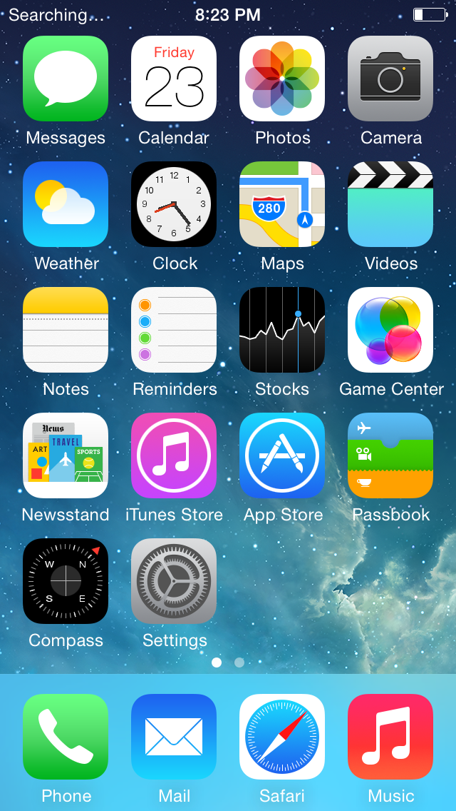
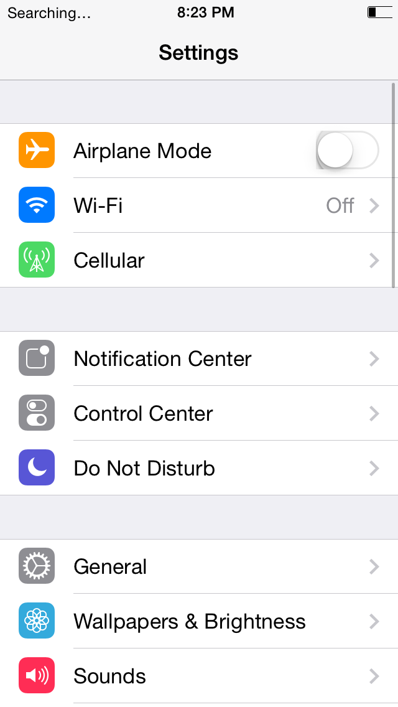

# vphone-legacy

Inspired by [vphone-cli](https://github.com/Lakr233/vphone-cli)

An experimental iPhone 5s emulator for **iPhone6,2 / n53ap / iOS 7.1.2 (11D257)** on Apple Silicon Macs. It combines a pinned QEMU backend, firmware preparation tools, and a software model of selected A7 peripherals and AGX rendering commands.

**Research software:** recorded local runs reach the original lock screen, Home, and Settings with guest touch input. A fresh IPSW preparation does **not** yet reproduce that configuration: the latest UI profile depends on additional local boot/keybag artifacts. See [current status](docs/status.md) and [firmware preparation](docs/firmware.md) before attempting a boot.

| Home | Settings |
| --- | --- |
|  |  |

*Latest available normal-speed live captures from `merge-u2-live` (2026-10-24), after the clock, blur, and UISwitch fixes. [Capture provenance](research/evidence/public-readme-20261024/README.md). These are recorded research-profile results, not screenshots produced by the quick start below.*

## Quick start: setup and tests

Requires macOS on Apple Silicon, Xcode Command Line Tools, Homebrew, Python 3.11+ (3.13 preferred), and a C compiler. No firmware is needed for the default tests. Intel Macs and other operating systems are not validated.

```sh
git clone https://github.com/rabbanilham/vphone-legacy.git
cd vphone-legacy
brew install python@3.13 keystone glib pixman openssl@3 qemu
make setup
make test
./vphone-legacy --help
```

The Homebrew QEMU package supplies `qemu-img` for disk conversion. Guest execution uses the separately built, pinned project backend:

```sh
.venv/bin/python scripts/qemu/build_backend.py --fetch --install-build-deps
.venv/bin/python backend/smoke_test.py
```

See [installation](docs/setup.md) for prerequisites, SDK selection, and overrides. Building QEMU requires network access, substantial disk space, and time. No firmware, prepared VM, or emulator binary is included.

## Using your own firmware

```sh
./vphone-legacy vm create ios712 --ios 7.1.2 --ipsw /path/to/iPhone6,2_7.1.2_11D257_Restore.ipsw
./vphone-legacy vm doctor ios712
./vphone-legacy vm launch ios712 --headless --probe-seconds 5
```

This prepares and probes the **baseline bring-up bundle**, not the UI profile pictured above. A successful `doctor` checks artifacts, not a completed iOS boot. Read [firmware and launch](docs/firmware.md) for the distinction and current blockers.

## Roadmap: performance and emulator quality

The next milestone is a reproducible, responsive iOS 7.1.2 session with reliable input and persistent data. The work below is planned, not a list of supported features. Prioritize correctness and measurements before changing timing or adding more firmware targets.

1. **Make the UI profile reproducible.** Complete the local IPSW → diagnostic disks → keybag/SMP boot plan → UI profile pipeline, with explicit inputs and validation. Investigate the baseline FIPS POST failure rather than treating QEMU exit code zero as success. Acceptance: a clean checkout can prepare the documented configuration without depending on another developer's artifact store.
2. **Establish repeatable performance baselines.** Measure cold boot to lock screen, swipe to settled Home, Settings launch, input latency, frame-time percentiles, host CPU use and peak memory. Record source/backend/input hashes, host configuration, guest time and wall time separately. Use lightweight captures for timing; full AGX dumps can stall the guest. Compare repeated runs of the same workload before and after each optimization.
3. **Remove measured execution and rendering bottlenecks.** Profile TCG execution, guest waits, device polling, renderer queue/BQL contention, texture access and framebuffer copies. Optimize the dominant costs while preserving interrupt delivery, draw ordering and existing device contracts. Trace the delayed unlock-to-Home commit and restore visible intermediate animation frames. Keep normal timing (`k=1`): the evaluated time-dilation settings did not complete unlock and are not a performance fix.
4. **Improve rendering fidelity.** Fix the remaining UISwitch shadow edge, verify the slider glint and the antialiased clock hands live, and read canvas-backdrop blur taps from the shader constants instead of a fixed 6-tap kernel. Use the chained offline corpus for focused regressions, then compare live captures across transitions; an offline replay alone does not establish correct guest rendering.
5. **Strengthen input, lifecycle and persistence.** Test repeated taps, swipes, sleep/wake and unlock across cold boots. Add graceful guest shutdown and verify storage flush behavior before claiming clean persistence. Acceptance: Settings, Calculator and Notes work through guest input, Notes data survives a clean restart, three cold boots complete, and a 15-minute session has no panic or unintended restart.
6. **Expand device compatibility incrementally.** Validate Wi-Fi/networking and remaining peripheral contracts using real guest behavior and failure cases. Keep experimental paths separate until accepted; a Home screenshot or a successful synthetic contract is not proof of complete device support. Broader iOS/device support follows a stable, reproducible n53ap baseline.

Each change should include relevant [tests](docs/testing.md), before/after evidence and an update to [known limitations](docs/status.md). Performance gains must retain the same guest workload and visible output; skipped rendering or altered guest time must not be counted as speed improvements.

## Documentation

- [Setup and backend build](docs/setup.md)
- [Firmware, VM lifecycle, and research profile](docs/firmware.md)
- [Status and known limitations](docs/status.md)
- [Architecture](docs/architecture.md) and [backend contracts](backend/README.md)
- [Testing](docs/testing.md) and [troubleshooting](docs/troubleshooting.md)
- [Contributing](CONTRIBUTING.md)
- [Research archive](research/README.md)
- [Third-party notices and license status](THIRD_PARTY_NOTICES.md)
- [Publication audit](docs/publication-audit.md)

## License status

The QEMU machine overlay declares **GPL-2.0-or-later**. A repository-wide license has not yet been established for the remaining code. See [third-party notices](THIRD_PARTY_NOTICES.md) for attribution and the unresolved licensing work before redistribution. Apple firmware and artwork are not project code.
